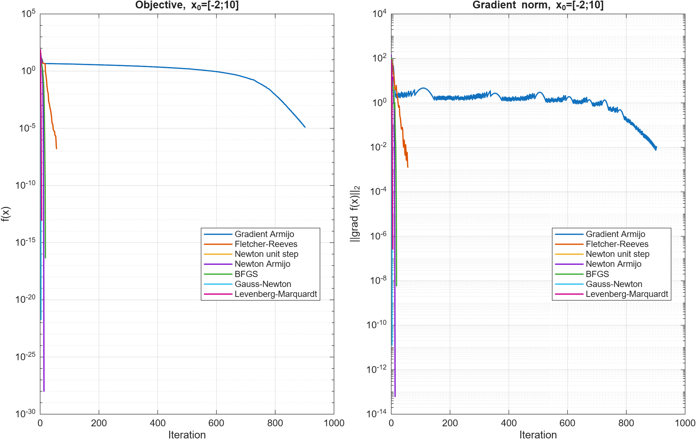
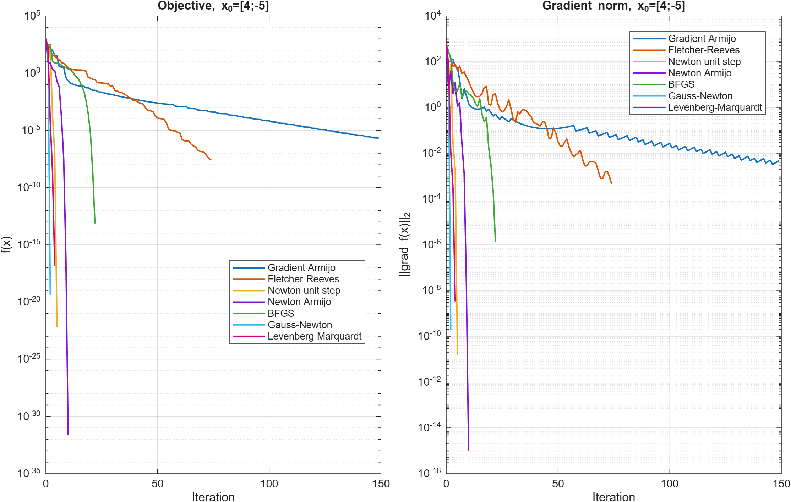

# Rosenbrock Optimization Methods

[English](README.md) | [Français](README.fr.md)

A from-scratch MATLAB implementation and comparison of classical nonlinear
optimization methods on the generalized Rosenbrock function. The project is
based on the first exercise of an educational scientific-computing assignment,
but it is organized as a reproducible numerical optimization study rather than
as a course submission.

## Implemented methods

- fixed-step gradient descent;
- gradient descent with Armijo backtracking;
- nonlinear conjugate gradient with the Fletcher-Reeves update;
- Newton's method with a unit step;
- safeguarded Newton's method with Armijo backtracking;
- inverse-BFGS quasi-Newton;
- Gauss-Newton;
- Levenberg-Marquardt with adaptive damping.

All methods share the same stopping criteria and history format. The code
distinguishes convergence by gradient norm, stagnation, iteration limits,
line-search failure, and divergence.

## Problem

The generalized objective is

$$
f(x)=\sum_{i=1}^{n-1}\left[b(x_{i+1}-x_i^2)^2+(1-x_i)^2\right],
$$

with $b>0$. Its unique global minimizer is
$x^\star=(1,\ldots,1)^T$, where $f(x^\star)=0$.

The experiments use $n=2$ and $b=2$. The implementation also provides the
analytical gradient, Hessian, residual vector, and residual Jacobian, with the
consistent convention

$$
f(x)=r(x)^Tr(x), \qquad \nabla f(x)=2J(x)^Tr(x).
$$

## Requirements

- MATLAB; tested with MATLAB R2025b;
- no Optimization Toolbox or Symbolic Math Toolbox is required;
- a LaTeX installation is optional and only needed to rebuild the report.

## Running the experiments

Open MATLAB in the repository root and run:

```matlab
main
```

The script performs finite-difference derivative checks, creates the objective
visualizations, evaluates the three fixed steps, and compares all seven
optimization configurations from the two prescribed initial points.

To regenerate the report figures and CSV tables separately, run:

```matlab
export_figures
```

Normal execution of `main.m` does not export files.

## Main numerical parameters

| Parameter | Value |
|---|---:|
| Rosenbrock coefficient $b$ | 2 |
| Gradient tolerance | $10^{-8}$ |
| Relative iterate tolerance | $10^{-8}$ |
| Relative objective tolerance | $10^{-8}$ |
| Maximum iterations | 1000 |
| Armijo constant | $10^{-4}$ |
| Backtracking reduction | 0.75 |
| Initial trial step | 1 |
| Fixed steps | $1$, $10^{-2}$, $10^{-4}$ |

## Selected results

The following iteration counts and stop reasons come from the reproducible CSV
generated by `export_figures.m`.

| Method | $x_0=(-2,10)^T$ | $x_0=(4,-5)^T$ |
|---|---:|---:|
| Gradient Armijo | 903 (`TolF`) | 149 (`TolF`) |
| Fletcher-Reeves | 57 (`TolF`) | 74 (`TolF`) |
| Newton unit step | 0 (`Divergence`) | 5 (`TolG`) |
| Newton Armijo | 13 (`TolG`) | 10 (`TolG`) |
| BFGS | 18 (`TolG`) | 22 (`TolF`) |
| Gauss-Newton | 3 (`TolG`) | 2 (`TolG`) |
| Levenberg-Marquardt | 5 (`TolF`) | 4 (`TolG`) |

A `TolF` stop is reported as objective stagnation, not automatically as
first-order convergence. The unit-step Newton result also demonstrates the
strong influence of the initial point.





## Repository structure

```text
.
├── main.m                  # complete experiment script
├── optimdescent.m          # optimization algorithms
├── rosenbrock.m            # objective, derivatives, residuals and Jacobian
├── verify_derivatives.m    # finite-difference verification
├── export_figures.m        # explicit figure and CSV export
├── figures/                # generated figures and numerical tables
├── rapport/Rapport.pdf     # compiled report
└── csopt_tp_2020.pdf       # original educational assignment
```

## Numerical safeguards

- Armijo tests are performed along a fixed descent direction.
- Stopping tests are applied only to accepted iterates.
- Newton's Hessian is symmetrized and shifted when Cholesky factorization
  detects that it is not positive definite.
- BFGS is restarted if the curvature condition is unreliable.
- Linear systems receive a small scale-dependent diagonal regularization.
- Levenberg-Marquardt accepts steps using an actual-to-predicted reduction
  ratio and adapts its damping parameter.

## Limitations

- The comparison is intentionally limited to the two-dimensional problem with
  $b=2$ and two initial points.
- Execution times are single-run measurements and are too short to support a
  robust performance ranking.
- The stopping criteria can detect stagnation before the gradient tolerance is
  reached.
- The implementation is educational and does not replace a production-grade
  optimization library.

## Documentation and references

The mathematical derivations, full result tables, and discussion are available
in [`rapport/Rapport.pdf`](rapport/Rapport.pdf). The report cites the original
Rosenbrock, Armijo, Fletcher-Reeves, Levenberg, and Marquardt publications.

The file `csopt_tp_2020.pdf` is retained as the pedagogical source of the first
exercise. Only Exercise 1 is implemented and discussed in this repository.

